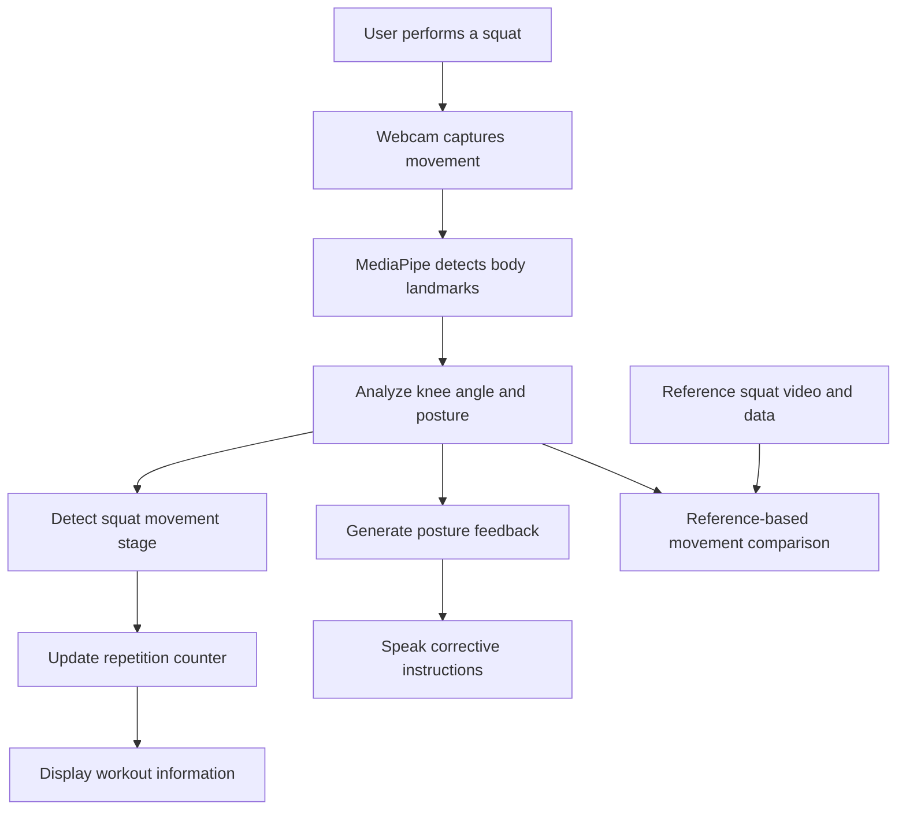

# 🏋️ MotionBuddy AI
### Your AI-Powered Workout Companion

<p align="center">
  <strong>Move Better. Train Smarter. Improve Every Rep.</strong>
</p>

<p align="center">
  An AI-powered fitness coaching prototype that uses computer vision
  to monitor exercise movements and provide real-time feedback.
</p>

<p align="center">
  
  
  
</p>

---

## 🌟 What is MotionBuddy?

Exercising at home can be difficult when there is no personal trainer to guide you. People may perform movements incorrectly without realizing it.

**MotionBuddy aims to make home workouts more interactive by acting as an AI-assisted workout companion.**

Using a webcam and computer vision, the current prototype detects body landmarks, analyzes squat movements, counts repetitions, and provides spoken posture guidance. A reference exercise video helps users understand the intended movement.

Our vision is to bring this interactive fitness experience to the television through Amazon Fire TV.

---

## 🎯 The Problem

- 🏠 People often exercise at home without professional guidance.
- 👀 Incorrect exercise posture can go unnoticed.
- 🔢 Counting repetitions manually can distract users from exercising.
- 🎥 Watching an exercise video alone does not provide personalized feedback.

## 💡 Our Solution

MotionBuddy combines reference exercise videos with webcam-based movement analysis to provide a more interactive workout experience.

| Challenge | MotionBuddy's approach |
|---|---|
| Difficulty following exercises | Display a reference squat video |
| Manual repetition counting | Automatically count detected squats |
| Posture mistakes | Analyze body landmarks and knee angles |
| Lack of immediate guidance | Provide spoken corrective instructions |
| Understanding exercise performance | Compare movement data with reference data |

---

## ✨ Key Features

### 🦴 1. AI Pose Detection
Uses MediaPipe Pose Landmarker to detect body landmarks from the webcam.

### 🔢 2. Automatic Squat Counter
Tracks squat movement stages and counts detected repetitions.

### 📐 3. Posture Monitoring
Analyzes knee angles and upper-body posture to identify selected movement issues.

### 🔊 4. Voice-Based Feedback
Provides spoken instructions to help users correct their movement.

### 🎬 5. Reference Exercise Video
Lets users observe a reference squat while following the exercise.

### 📊 6. Movement Comparison
The prototype includes a reference-based movement comparison workflow intended to assess exercise performance.

### 📺 7. Fire TV Experience — In Progress
The Android TV application is being developed to bring workout guidance to a larger screen. Full integration with the Python AI prototype has not yet been verified.

---

## 🖥️ How It Works



### Workflow

1. The user starts MotionBuddy and positions themselves in front of the webcam.
2. The system detects body landmarks.
3. Knee angles and posture measurements help track squat movements.
4. The squat counter updates when a repetition is detected.
5. The application provides spoken guidance when selected posture issues are identified.
6. Reference movement data can be used for movement comparison.

---

## 🛠️ Technology Stack

| Technology | Purpose |
|---|---|
| Python | Core prototype and application logic |
| MediaPipe Tasks | Body pose and landmark detection |
| OpenCV | Webcam processing and visual display |
| NumPy | Numerical calculations for movement analysis |
| pyttsx3 | Offline text-to-speech feedback |
| Android Studio | Android TV application development |
| Kotlin | Android TV application logic |

---

## 🚀 Getting Started

### Prerequisites

- Windows laptop or PC
- Python installed
- Webcam
- Working microphone/speaker output is not required; speakers or headphones are needed to hear voice feedback
- The project files listed below

### 1. Clone the repository

```bash
git clone https://github.com/sameena-firdouse/MotionBuddy.git
cd MotionBuddy
```

### 2. Create a virtual environment

```bash
python -m venv .venv
```

Activate it in Windows PowerShell:

```powershell
.\.venv\Scripts\Activate.ps1
```

If PowerShell blocks activation, you can use the environment's Python executable directly instead.

### 3. Install the Python dependencies

```bash
python -m pip install opencv-python mediapipe numpy pyttsx3
```

Use the Python version and dependency versions compatible with your existing project if installation fails.

### 4. Check the required files

Make sure the Python application can access its required assets:

```text
MotionBuddy/
├── main.py
├── extract_reference.py
├── pose_landmarker_lite.task
├── reference_squat.mp4
├── reference_squat.json
└── README.md
```

The exact repository contents may vary. The pose model, reference video, and reference data must be present at the paths expected by the code.

### 5. Run MotionBuddy

```bash
python main.py
```

Allow webcam access if prompted. Stand far enough from the camera for the application to detect your body, then perform a slow squat.

Follow the on-screen instructions and listen for spoken feedback.

> **Note:** The instructions above describe the Python prototype. The Android TV app requires its own Android Studio build and setup process.

---

## 📺 Amazon Fire TV Integration

MotionBuddy is being developed with a TV-based workout experience in mind.

The intended experience includes:

- A TV-friendly workout interface
- Reference exercise guidance
- Workout counters and movement feedback
- Integration with the computer-vision coaching system

**Current status:** The Python prototype works on a laptop. Android TV development has started, but the complete TV-to-AI integration and installation have not yet been verified.

---

## 🗺️ Project Roadmap

- [x] Webcam-based pose detection
- [x] Squat repetition counter
- [x] Basic posture monitoring
- [x] Spoken feedback
- [x] Reference squat video and data
- [x] Initial reference-based movement comparison workflow
- [ ] Verify live communication between the Python prototype and Android TV app
- [ ] Complete and test the TV workout experience
- [ ] Expand support to more exercises
- [ ] Improve movement analysis and personalized coaching

---

## 🔮 Future Scope

- 🏃 Support for lunges, push-ups, and other exercises
- 💃 Guided dance and movement practice
- 📈 Workout history and progress tracking
- 🎯 Personalized exercise recommendations
- 📺 A complete Fire TV workout interface
- 🗣️ More contextual voice guidance

---

## 👥 Who Can Benefit?

- Beginners learning basic exercises
- People exercising at home
- Users who want visual and spoken guidance
- People who prefer following workouts on a television

MotionBuddy is intended to supplement exercise guidance, not replace a qualified fitness professional.

---

## ⚠️ Current Limitations

- The working demonstration currently focuses on squats.
- Pose detection depends on camera visibility, lighting, and body positioning.
- Posture checks cover selected movement conditions rather than every possible exercise mistake.
- Movement comparison is an experimental aid and should not be interpreted as a medical or professional form assessment.
- The complete Fire TV integration is still in progress.

---

## 💜 Our Vision

We believe technology can make exercise guidance more accessible and interactive.

**MotionBuddy aims to turn a workout video into a more responsive workout experience — one movement at a time.**

---

<p align="center">
  <strong>MotionBuddy AI</strong><br/>
  <em>Move Better. Train Smarter. Improve Every Rep.</em>
</p>
