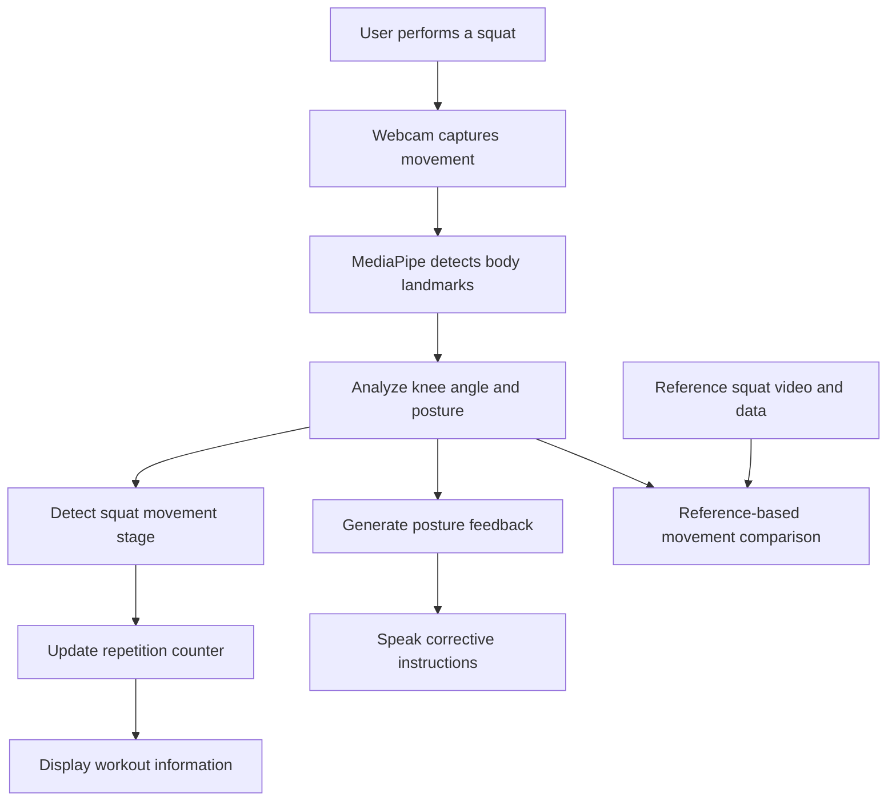

# 🏋️ MotionBuddy AI
### Your AI-Powered Workout Companion

<p align="center">
  <strong>Move Better. Train Smarter. Improve Every Rep.</strong>
</p>

<p align="center">
  An AI-powered fitness coaching application that uses computer vision
  to monitor exercise movements and provide real-time feedback.
</p>

<p align="center">
  
  
  
  
</p>

---

## 🌟 What is MotionBuddy?

Exercising at home can be challenging when there is no personal trainer to guide you. People may perform movements incorrectly without realizing it.

**MotionBuddy aims to make home workouts more interactive by acting as an AI-assisted workout companion.**

Using a webcam and computer vision, MotionBuddy detects body landmarks, analyzes squat movements, counts repetitions, and provides spoken posture guidance. A reference exercise video helps users understand the intended movement.

The goal is to make workout guidance more accessible, interactive, and easier to follow.

---

## 🎯 The Problem

- 🏠 People often exercise at home without professional guidance.
- 👀 Incorrect exercise posture can go unnoticed.
- 🔢 Counting repetitions manually can distract users.
- 🎥 Watching exercise videos alone does not provide personalized feedback.

## 💡 Our Solution

MotionBuddy combines reference exercise videos with webcam-based movement analysis to provide a more interactive workout experience.

| Challenge | MotionBuddy's approach |
|---|---|
| Difficulty following exercises | Display a reference squat video |
| Manual repetition counting | Automatically count detected squats |
| Posture mistakes | Analyze body landmarks and knee angles |
| Lack of immediate guidance | Provide spoken corrective instructions |
| Understanding exercise performance | Compare movement data with reference data |

---

## ✨ Key Features

### 🦴 1. AI Pose Detection
Uses MediaPipe Pose Landmarker to detect body landmarks from the webcam.

### 🔢 2. Automatic Squat Counter
Tracks squat movement stages and counts detected repetitions.

### 📐 3. Posture Monitoring
Analyzes knee angles and upper-body posture to identify selected movement issues.

### 🔊 4. Voice-Based Feedback
Provides spoken instructions to help users correct their movement.

### 🎬 5. Reference Exercise Video
Lets users observe a reference squat while following the exercise.

### 📊 6. Movement Comparison
Includes a reference-based movement comparison workflow intended to assess exercise performance.

---

## 🖥️ How It Works



### Workflow

1. The user starts MotionBuddy and positions themselves in front of the webcam.
2. The system detects body landmarks.
3. Knee angles and posture measurements help track squat movements.
4. The squat counter updates when a repetition is detected.
5. The application provides spoken guidance when selected posture issues are identified.
6. Reference movement data can be used for movement comparison.

---

## 🛠️ Technology Stack

| Technology | Purpose |
|---|---|
| Python | Core application logic |
| MediaPipe Tasks | Body pose and landmark detection |
| OpenCV | Webcam processing and visual display |
| NumPy | Numerical calculations for movement analysis |
| pyttsx3 | Offline text-to-speech feedback |

---

## 🚀 Getting Started

### Prerequisites

- Windows laptop or PC
- Python installed
- Webcam
- Speakers or headphones to hear voice feedback

### 1. Clone the repository

```bash
git clone https://github.com/sameena-firdouse/MotionBuddy.git
cd MotionBuddy
```

### 2. Create a virtual environment

```bash
python -m venv .venv
```

Activate it in Windows PowerShell:

```powershell
.\.venv\Scripts\Activate.ps1
```

If PowerShell blocks activation, you can use the environment's Python executable directly instead.

### 3. Install the dependencies

```bash
python -m pip install opencv-python mediapipe numpy pyttsx3
```

Use dependency versions compatible with your existing project if installation fails.

### 4. Check the project files

```text
MotionBuddy/
├── main.py
├── extract_reference.py
├── pose_landmarker_lite.task
├── reference_squat.mp4
├── reference_squat.json
└── README.md
```

Make sure the required model, reference video, and reference data are present at the paths expected by the code.

### 5. Run MotionBuddy

```bash
python main.py
```

Allow webcam access if prompted. Stand far enough from the camera for the application to detect your body, then perform a slow squat.

Follow the on-screen instructions and listen for spoken feedback.

---

## 🗺️ Project Roadmap

- [x] Webcam-based pose detection
- [x] Squat repetition counter
- [x] Basic posture monitoring
- [x] Spoken feedback
- [x] Reference squat video and data
- [x] Initial reference-based movement comparison workflow
- [ ] Improve movement analysis and feedback accuracy
- [ ] Add support for more exercises
- [ ] Introduce workout history and progress tracking
- [ ] Expand personalized coaching capabilities

---

## 🔮 Future Scope

- 🏃 Support for lunges, push-ups, and other exercises
- 💃 Guided dance and movement practice
- 📈 Workout history and progress tracking
- 🎯 Personalized exercise recommendations
- 🗣️ More contextual voice guidance
- 📊 Improved movement comparison and performance insights

---

## 👥 Who Can Benefit?

- Beginners learning basic exercises
- People exercising at home
- Users who want visual and spoken guidance
- People looking for a more interactive workout experience

MotionBuddy is intended to supplement exercise guidance, not replace a qualified fitness professional.

---

## ⚠️ Current Limitations

- The working demonstration currently focuses on squats.
- Pose detection depends on camera visibility, lighting, and body positioning.
- Posture checks cover selected movement conditions rather than every possible exercise mistake.
- Movement comparison is an experimental aid and should not be interpreted as a medical or professional form assessment.

---

## 💜 Our Vision

We believe technology can make exercise guidance more accessible and interactive.

**MotionBuddy aims to turn a workout video into a more responsive workout experience — one movement at a time.**

---

<p align="center">
  <strong>MotionBuddy AI</strong><br/>
  <em>Move Better. Train Smarter. Improve Every Rep.</em>
</p>
